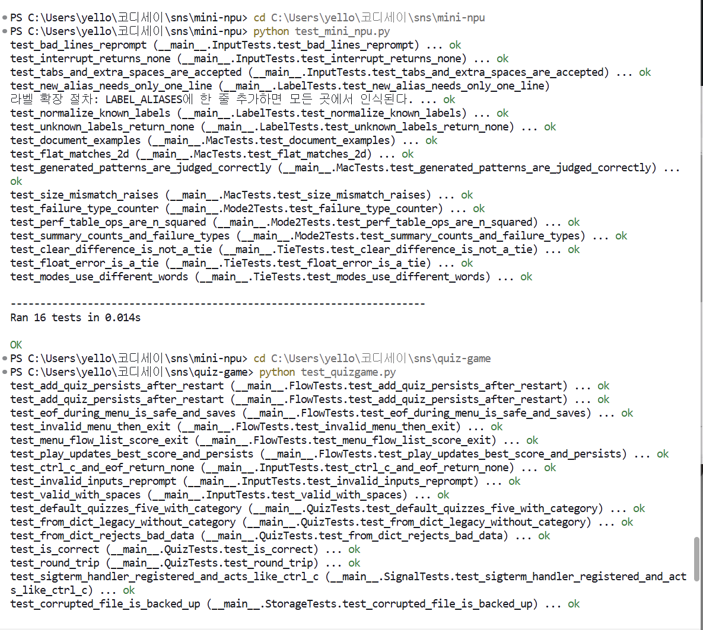
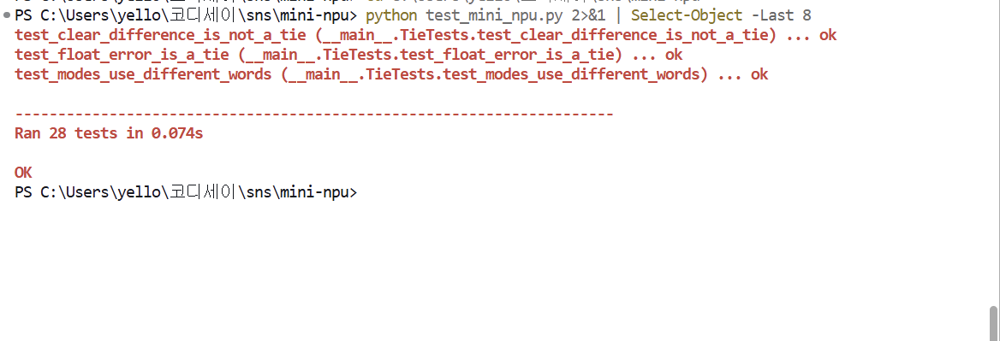
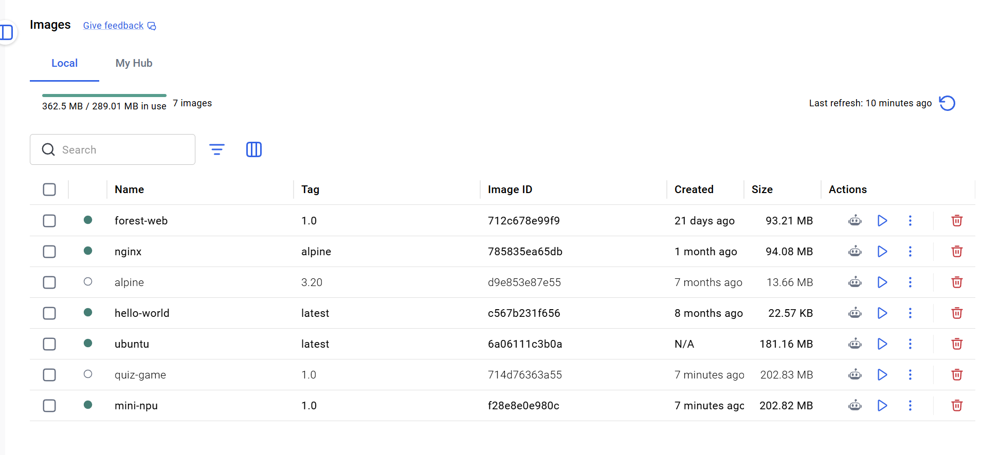

# Mini NPU 시뮬레이터

십자가(Cross)와 X 패턴을 **MAC(곱하고 더하기) 연산 점수**로 판별하는 Python 콘솔 프로그램입니다. NumPy 없이 반복문만 사용했습니다.

> 🆕 **평가 피드백을 반영했습니다.** 바뀐 곳은 🔧(코드) 🧪(테스트) 📝(문서) 📊(측정·증빙) 아이콘으로 표시했고, 전체 목록은 [8장](#8-평가-피드백-반영-보완-내용)(1차)과 [9장](#9-2차-평가-피드백-반영-보완-내용)(2차)에 있습니다.
>
> 🚨 **데이터 정정:** 처음에는 제가 만든 `data.json`(9개)으로 분석했는데, **과제가 제공한 `data.json`(6개)과 달랐습니다.** 제공 데이터로 바꾸고 결과와 분석을 모두 다시 썼습니다. 자세한 내용은 [11장](#11-데이터-정정-과제-제공-datajson-적용)을 보세요.

📝 **점수 읽는 법:** MAC 점수는 *패턴과 필터가 같은 위치에서 함께 1인 칸의 수*입니다. **높은 MAC 점수는 필터와 입력이 더 많이 일치한다(더 닮았다)는 뜻**이고, 두 필터 중 점수가 더 높은 쪽으로 판정합니다. 예: 십자가 패턴은 십자가 필터와 5점, X 필터와 1점이라서 Cross로 판정됩니다.

> 💬 **평가 질문 A2** — 패턴과 필터를 곱하고 더해서 유사도(점수)를 계산하는 원리를 설명해 주세요. → [답변 보기](docs/QNA.md#a2)


> 📚 **평가 문항별 질문과 답변:** 모든 문항의 답변은 [docs/QNA.md](docs/QNA.md)에 있고, 이 문서의 해당 절마다 💬 **평가 질문** 주석에서 바로 연결됩니다.

## 1. 실행 방법

```
python main.py
```

| 선택 | 모드 | 설명 |
|---|---|---|
| 1 | 사용자 입력 (3x3) | 필터 A, 필터 B, 패턴을 한 줄에 3개씩 **공백으로 구분**해 입력 (예: `0 1 0`) |
| 2 | data.json 분석 | 과제 제공 데이터: 필터 3종(5x5, 13x13, 25x25)과 테스트 케이스 **6개**를 자동 판정하고 성능 표와 결과 요약 출력 |

| 3 | 보너스 | N(3~25)을 입력하면 N×N 십자가·X 패턴을 자동 생성해 판정하고, 2차원 vs 1차원 배열 MAC 성능을 비교 |

- Python 3.8 이상, 외부 라이브러리 없음
- `data.json`은 `main.py`와 같은 폴더에 있어야 합니다.

### 1-1. 📝 모드 1 입력 예시와 출력 형식

> 💬 **평가 질문 B2** — 모드 1(사용자 입력)의 입력 검증은 어떻게 했나요? → [답변 보기](docs/QNA.md#b2)

입력은 **공백이든 탭이든 상관없이** 숫자들을 나눠 읽고, 앞뒤 공백과 여러 칸 공백도 무시합니다. (`line.split()` 사용) 🧪 `test_tabs_and_extra_spaces_are_accepted`

| 입력한 줄 | 결과 |
|---|---|
| `0 1 0` | ✅ 정상 |
| `0<탭>1<탭>0`, `  1   1   1  ` | ✅ 정상 (탭, 여러 칸 공백, 앞뒤 공백 허용) |
| `010` (붙여 씀) | ❌ 숫자 하나(10)로 읽혀 열 개수 불일치 → 안내 후 **그 줄만** 재입력 |
| `1 2`, `a b c`, (빈 줄) | ❌ `입력 형식 오류: 각 줄에 3개의 숫자를 공백으로 구분해 입력하세요.` |

출력 형식은 항상 아래와 같습니다. (점수는 **실수 그대로**, 시간은 **밀리초, 소수 셋째 자리**)
```text
A 점수: 1.0
B 점수: 5.0
연산 시간(평균/10회): 0.012 ms
판정: B
```

### 1-2. 📝 data.json 스키마와 예외 처리 정책

> 💬 **평가 질문 B3** — 모드 2는 크기 불일치·스키마 오류에도 멈추지 않나요? → [답변 보기](docs/QNA.md#b3)

| 구분 | 기대 형식 | 규칙 |
|---|---|---|
| `filters` | `size_{N}` 키, 값은 `{"cross": N×N, "x": N×N}` | 키의 N과 실제 필터 크기가 같아야 함. 라벨 키(`cross`, `x`)는 정규화함 |
| `patterns` | `size_{N}_{idx}` 키, 값은 `{"input": N×N, "expected": 라벨}` | **키의 N으로 `size_N` 필터를 고름.** 패턴 크기도 N이어야 함 |

| 잘못된 데이터 | 처리 정책 |
|---|---|
| `filters`에서 `size_숫자` 형식이 아닌 키 | **건너뜀**(무시) |
| 필터의 크기·라벨·모양 오류 | 해당 크기 필터를 `✗ … 로드 실패`로 표시하고, 그 크기 패턴은 모두 FAIL |
| 패턴 키가 `size_{N}_{idx}`가 아님, `input`/`expected` 없음 | 그 케이스만 FAIL (`스키마 오류`) |
| `expected`가 알 수 없는 라벨 | 그 케이스만 FAIL (`라벨 오류`) |
| 패턴과 필터 크기 불일치 | 그 케이스만 FAIL (`크기 불일치`) |
| 파일이 없거나 JSON이 깨짐 | 안내 후 종료 (프로그램은 비정상 종료하지 않음) |

## 2. 구현 요약

> 💬 **평가 질문 A1** — MAC(Multiply-Accumulate) 연산이 무엇이고, AI에서 왜 중요한가요? → [답변 보기](docs/QNA.md#a1)
>
> 💬 **평가 질문 A3** — data.json의 "키 규칙/라벨 규칙"을 해석하고, 라벨을 정규화하는 이유를 설명해 주세요. → [답변 보기](docs/QNA.md#a3)
>
> 💬 **평가 질문 A4** — 부동소수점 오차가 판정에 어떤 영향을 주는지, 왜 허용오차(epsilon) 비교가 필요한가요? → [답변 보기](docs/QNA.md#a4)
>
> 💬 **평가 질문 B1** — 데이터 구조는 어떻게 구현했나요? → [답변 보기](docs/QNA.md#b1)


- `Grid`: N x N 숫자표 (입력 검증, 값 읽기/쓰기, 출력)
- `mac(pattern, filter)`: 같은 칸끼리 곱해서 모두 더하는 연산 (크기가 다르면 오류)
  - 📝 **반복 순서:** 바깥 반복이 행, 안쪽 반복이 열인 **행 우선(row-major)** 입니다. 파이썬 리스트는 같은 행의 칸이 메모리에서 이웃해 있어 이 순서가 가장 자연스럽고, 순서가 바뀌어도 연산 횟수(N²)는 같습니다. 정밀도는 **더하는 순서에 따라 마지막 자리 오차**가 달라질 수 있어서(예: `0.1+0.2+0.3`) 허용오차 비교를 씁니다. 0과 1만 쓰는 패턴은 합이 정수라 오차가 생기지 않습니다.
- `normalize_label`: `+`, `cross` → `Cross` / `x` → `X` 로 표기를 통일. 🔧 표기 목록은 `LABEL_ALIASES` 딕셔너리 한 곳에 모았습니다.
  - 📝 **함수로 분리한 이유:** ① **중앙집중화** — 필터 키, expected, 출력 비교가 모두 같은 규칙을 쓰므로 표기 규칙이 어긋날 수 없음 ② **재사용성** — 필터 로드와 패턴 분석 두 곳에서 같은 함수를 호출 ③ **테스트 용이성** — 입출력이 단순해 한 줄씩 시험 가능(🧪 `LabelTests`) ④ **확장 용이성** — 새 표기는 `LABEL_ALIASES`에 한 줄만 추가(8-3 체크리스트).
- 판정: 두 점수 차이가 `1e-9` 미만이면 **동점**으로 보고 판정 불가(UNDECIDED)로 처리 (부동소수점 오차 대비)
  - 📊 **EPSILON `1e-9`을 고른 근거(실험):** ① 과제 제공 `data.json`에서 **동점으로 보아야 하는 케이스의 점수 차이는 `1.11e-16`, `2.66e-15`, `1.78e-15`** 이고, **분명히 다른 케이스의 차이는 최소 `8.8`** 입니다. 두 집단 사이가 약 `10^15`배나 벌어져 있어 그 사이 어디에 기준을 둬도 구분됩니다. ② 소수 0.1 단위 값 625개를 서로 반대 순서로 더하는 실험을 2만 번 했을 때 **순서 때문에 생긴 최대 차이는 `1.14e-12`** 였습니다. ③ 따라서 `1e-9`은 실제 오차(`~1e-12`)보다 약 **1,000배 크고**, 실제 점수 차이(≥8.8)보다 **약 10억 배 작아서** 오차만 동점으로 걸러내고 진짜 차이는 놓치지 않습니다.
- 문제가 있는 케이스는 프로그램을 멈추지 않고 그 케이스만 FAIL로 기록하고 다음으로 진행

## 3. 실행 결과 (증빙)

| 화면 | 파일 |
|---|---|
| 모드 1 잘못된 입력 처리 + 커밋 | `docs/screenshots/M7_mode1_error_commit.png` |
| 모드 1 판정 결과 + 3x3 성능 표 | `docs/screenshots/M6_mode1_result.png` |
| 모드 2 분석 커밋 | `docs/screenshots/M8_mode2_commit.png` |
| 모드 2 성능 표 + 결과 요약 | `docs/screenshots/M9_mode2_perf_summary_commit.png` |


> ⚠️ **위 모드 2 화면은 정정 전 데이터(9개, 통과 6) 기준입니다.** 과제 제공 데이터(6개, 통과 3)로 다시 캡처한 화면은 11장에 있습니다.

## 4. 결과 리포트

> 💬 **평가 질문 B5** — 결과 리포트(콘솔·README)에는 무엇을 담았나요? → [답변 보기](docs/QNA.md#b5)


### 4-1. 요약

> 💬 **평가 질문 B4** — 판정과 PASS/FAIL 규칙은? → [답변 보기](docs/QNA.md#b4)
>
> 💬 **평가 질문 E4** — 모드 1과 모드 2의 동점 처리는 왜 다르나요? → [답변 보기](docs/QNA.md#e4)


| 항목 | 값 |
|---|---|
| 총 테스트 | 6개 (과제 제공 `data.json`) |
| 통과 | 3개 |
| 실패 | 3개 (모두 부동소수점 동점) |

**🔧📝 실패 유형별 통계 (콘솔의 `결과 요약`에도 출력됩니다)**

| 실패 유형 | 개수 | 케이스 | 원인 분류 |
|---|---|---|---|
| 동점(UNDECIDED) | 3 | size_5_1, size_13_2, size_25_1 | 수치 비교 |
| 라벨 오류 | 0 | - | 데이터·스키마 |
| 크기 불일치 | 0 | - | 데이터·스키마 |
| 판정 불일치(로직) | 0 | - | 로직 |
| **합계** | **3** | | |

📊 **기계가 읽기 쉬운 요약 (한 줄 표)**

| total | pass | fail | fail_label | fail_size | fail_tie | fail_schema | fail_logic |
|---|---|---|---|---|---|---|---|
| 6 | 3 | 3 | 0 | 0 | 3 | 0 | 0 |

📝 **동점은 어떻게 집계되나요?** 동점(UNDECIDED)은 정답을 정할 수 없는 상태이므로 expected와 상관없이 **FAIL로 집계**하고, 아래처럼 `동점(UNDECIDED)` 이라는 별도 유형으로 표시합니다. 로그 예시:
```text
--- size_5_1 ---
Cross 점수: 0.9
X 점수: 0.8999999999999999
판정: UNDECIDED | expected: X | FAIL (동점(UNDECIDED))
...
실패 유형별 개수:
- 동점(UNDECIDED): 3건
```

📝 **모드 1과 모드 2의 동점 처리 차이**

| | 모드 1 (사용자 입력) | 모드 2 (data.json) |
|---|---|---|
| 동점일 때 출력 | `판정: 판정 불가 (\|A-B\| < 1e-9)` | `판정: UNDECIDED` |
| expected와 비교 | 없음 (정답이 없음) | 있음 → 동점이면 FAIL로 집계 |
| 이유 | 사용자가 A/B를 직접 비교하는 용도 | 자동 채점이라 PASS/FAIL이 필요 |

### 4-2. 실패 케이스 원인 분석

> 💬 **평가 질문 A6** — 실패 케이스를 "데이터/스키마 문제 vs 로직 문제 vs 수치 비교 문제"로 나누어 진단·개선해 주세요. → [답변 보기](docs/QNA.md#a6)

🚨 **정정:** 이 절은 과제가 제공한 `data.json`(6개) 기준으로 다시 썼습니다. 정정 전(제가 만든 9개 데이터)의 분석은 11장에 남겨 두었습니다.

| 케이스 | expected | Cross 점수 | X 점수 | 판정 | 결과 | 원인 분류 |
|---|---|---|---|---|---|---|
| size_5_1 | x | 0.9 | 0.8999999999999999 | UNDECIDED | FAIL | 수치 비교 |
| size_5_2 | + | 8.9 | 0.1 | Cross | PASS | - |
| size_13_1 | x | 0.3 | 14.700000000000008 | X | PASS | - |
| size_13_2 | + | 7.499999999999997 | 7.5 | UNDECIDED | FAIL | 수치 비교 |
| size_25_1 | x | 4.9 | 4.899999999999999 | UNDECIDED | FAIL | 수치 비교 |
| size_25_2 | + | 52.9 | 0.1 | Cross | PASS | - |

**수치 비교 문제 (size_5_1, size_13_2, size_25_1): 실패 3건 전부**
1. 세 케이스는 **수학적으로는 두 점수가 정확히 같도록** 만들어진 데이터입니다. size_5_1을 보면 X 패턴은 1이 9칸이고 X 필터는 칸마다 0.1이라 `0.1 × 9 = 0.9`, Cross 필터는 가운데 값이 0.9라 `0.9`입니다.
2. 그런데 컴퓨터는 소수를 2진수로 저장해서 `0.1`을 9번 더하면 `0.8999999999999999`가 됩니다. 같은 값이 `0.9`와 `0.8999999999999999`로 갈라졌습니다.
3. 차이는 `1.11e-16`(size_5_1), `2.66e-15`(size_13_2), `1.78e-15`(size_25_1)로, 사람 눈에는 같은 점수입니다.
4. 그런데 `>`로 단순 비교하면 아주 조금 큰 쪽이 이기므로, **우연한 오차가 판정을 정하게 됩니다.** size_5_1에서는 Cross가 0.9로 더 커서 Cross로 잘못 판정되고(정답은 X), size_13_2에서는 반대로 X가 7.5로 더 커서 X로 잘못 판정됩니다(정답은 Cross).
5. 그래서 두 점수 차이가 허용오차 `1e-9`보다 작으면 같은 점수로 보고 `UNDECIDED`로 처리하는 규칙을 넣었습니다. 위 세 케이스는 모두 이 규칙에 걸립니다.
6. 과제 규칙은 "동점은 FAIL로 기록"이므로, 이 세 건은 **프로그램이 의도대로 동작한 FAIL**입니다. 오차 때문에 엉뚱한 판정을 내리는 것보다 "판정 불가"라고 알려 주는 편이 더 정직합니다.
7. 값이 이렇게 설계된 이유도 읽힙니다. 5x5 필터의 가운데 값 `0.9`, 13x13의 `7.5`, 25x25의 `4.9`는 "이 필터가 같은 패턴을 만나면 반대 필터와 점수가 꼭 같아지도록" 맞춘 값이라, 허용오차 정책이 없으면 **어느 쪽이 이길지 오차가 정합니다.**

**데이터·스키마 문제: 0건**
8. 라벨 정규화(`x`, `+`)와 필터 크기·패턴 크기 검증을 모두 통과했습니다. expected는 `x`와 `+`뿐이라 정규화로 `X`와 `Cross`가 되었고, 모든 패턴의 크기가 필터와 맞았습니다.
9. 그래도 이 검사는 필요합니다. 데이터가 잘못되면 프로그램이 멈추지 않고 그 케이스만 FAIL로 표시해야 하기 때문입니다. 이 경로는 **일부러 잘못 만든 시연용 데이터**로 따로 검증했습니다(4-4).

**로직 문제: 0건**
10. 정상 케이스 3개(size_5_2, size_13_1, size_25_2)는 점수 차이가 `8.8` 이상으로 분명했고 expected와 일치했습니다. MAC 계산과 판정 규칙 자체가 틀려서 생긴 실패는 없습니다.
11. 특히 size_13_1은 X 점수 `14.700000000000008`처럼 오차가 끼어도 Cross 점수 `0.3`과의 차이(14.4)가 커서 정확히 X로 판정되었습니다. **오차가 문제가 되는 것은 점수가 서로 거의 같을 때뿐**이라는 것을 보여 줍니다.
12. 라벨 표기(`x`, `+`)가 `Cross`, `X`와 달라도 정규화 덕분에 같은 라벨로 비교되었습니다.

**개선하려면:** 동점을 FAIL로 두는 것은 과제 규칙이므로 그대로 두고, 실제 서비스라면 점수를 `필터의 합`으로 나눠 비율로 비교하거나(9-6) 동점일 때 사용자에게 재확인을 요청하는 방식을 고려할 수 있습니다.

### 4-4. 실패 처리 시연용 데이터 (`data_failure_demo.json`)
과제 제공 데이터에는 라벨 오류나 크기 불일치가 없어서, **프로그램이 잘못된 데이터에도 멈추지 않는지**는 따로 확인했습니다. 제가 만든 9개 케이스(`data_failure_demo.json`)에는 일부러 잘못된 데이터가 3개 들어 있습니다. 🧪 `test_demo_data_covers_label_and_size_errors`

```powershell
$env:MINI_NPU_DATA = "data_failure_demo.json"
python main.py        # 모드 2 선택
Remove-Item Env:MINI_NPU_DATA
```
| 케이스 | 원인 | 분류 |
|---|---|---|
| size_5_3 | `expected`가 `?` → `라벨 오류` | 데이터·스키마 |
| size_13_1 | 부동소수점 동점 → `동점(UNDECIDED)` | 수치 비교 |
| size_25_3 | 패턴 5x5, 필터 25x25 → `크기 불일치` | 데이터·스키마 |

결과는 총 9, 통과 6, 실패 3(라벨 1, 크기 1, 동점 1)이고, **세 경우 모두 프로그램은 멈추지 않고 그 케이스만 FAIL**로 처리하고 나머지를 계속 판정합니다.

### 4-3. 성능 분석 (직접 측정)

> 💬 **평가 질문 A5** — 크기별 연산 시간을 측정하고, 시간 복잡도 O(N²)를 근거와 함께 설명해 주세요. → [답변 보기](docs/QNA.md#a5)
>
> 💬 **평가 질문 E1** — CPU와 NPU의 병목은 각각 무엇인가요? → [답변 보기](docs/QNA.md#e1)


각 크기를 10번 반복해 평균을 냈고, 시간은 `time.perf_counter()`로 쟀습니다.

| 크기 | 평균 시간(ms) | 연산 횟수(N²) | 회당(µs) |
|---|---|---|---|
| 3x3 | 0.004 | 9 | 0.416 |
| 5x5 | 0.010 | 25 | 0.406 |
| 13x13 | 0.042 | 169 | 0.246 |
| 25x25 | 0.149 | 625 | 0.239 |

- 📝 **표 읽는 법:** `평균 시간(ms)` = 10번 잰 시간의 평균(밀리초, 소수 3자리), `연산 횟수(N²)` = N×N, `회당(µs)` = `평균 시간(ms) × 1000 ÷ N²` (곱셈 한 번당 마이크로초).
- 📝 **측정 경계:** `time.perf_counter()`로 **`mac()` 함수 호출 직전과 직후만** 잽니다. 입력 읽기, 파일(`data.json`) 읽기, 화면 출력, 패턴·필터 만들기(`make_cross`)는 측정에서 **제외**합니다.
- **연산 횟수는 N²** 입니다. 크기가 5x5에서 25x25로 5배 커지면 연산 횟수는 25배(25 → 625)가 됩니다.
  - 📝 수식으로: 연산 횟수 = N². N을 k배 하면 (kN)² = **k²·N²** 이므로 연산은 k² 배. 예: N=5 → 25 (25회), N=10 → 100 (4배), N=25 → 625 (25배), N=100 → 10,000 (400배).
- 측정 시간도 같은 방향으로 늘었습니다. 5x5(0.010ms)에서 25x25(0.149ms)로 약 15배입니다.
- 25배가 아니라 약 15배인 이유는 **작은 크기에서는 함수 호출 같은 고정 비용이 시간의 큰 부분**을 차지하기 때문입니다. 그래서 칸 하나당 시간(µs)은 큰 크기일수록 약간 줄어들어 0.24µs 안팎으로 안정됩니다.
- 결론: MAC 연산은 시간 복잡도 **O(N²)** 입니다. 크기가 커질수록 계산량이 제곱으로 늘어나므로, 실제 NPU는 이 곱셈·덧셈을 한꺼번에 처리하는 전용 하드웨어를 씁니다.
- 시간 값은 컴퓨터와 실행 시점에 따라 조금씩 달라질 수 있습니다. 연산 횟수는 항상 같습니다.

📝 **CPU와 NPU의 병목 비교**

| | CPU | NPU |
|---|---|---|
| 처리 방식 | 소수의 강력한 코어가 명령을 **직렬**(순서대로)로 처리 | 수천 개의 단순한 **MAC 유닛**이 곱셈·덧셈을 **동시에(병렬)** 처리 |
| 대표 병목 | **연산 병렬성 부족**: 곱셈을 한 번에 몇 개밖에 못 함. 이 프로그램의 이중 반복문이 그 예 | **메모리 대역폭**: 연산 유닛은 빠른데 필터·입력 값을 메모리에서 가져오는 속도가 모자라 놀게 됨 |
| 해결 방향 | 벡터·SIMD, 멀티코어 | 값을 칩 안 버퍼에 재사용(데이터 이동 줄이기), 낮은 정밀도(int8) 사용 |

즉 **CPU는 계산할 수 있는 개수가 병목이고, NPU는 데이터를 가져오는 속도가 병목**입니다.

## 5. 보너스 과제 결과 (모드 3)

### 5-1. 패턴 생성기

> 💬 **평가 질문 D1** — 패턴 생성기를 어떻게 만들었나요? → [답변 보기](docs/QNA.md#d1)

- `make_cross(n)`, `make_x(n)`가 N×N 십자가(가운데 행·열)와 X(두 대각선)를 자동으로 만듭니다.
- 생성한 패턴은 모드 3의 판정(7x7 입력 시 Cross 패턴 → Cross 13.0 vs X 1.0, X 패턴 → Cross 1.0 vs X 13.0)과 성능 분석에 그대로 재사용합니다.

### 5-2. 1차원 배열 최적화 (2차원 vs 1차원)

> 💬 **평가 질문 D2** — 1차원 배열로 바꾸면 왜 빨라지나요? → [답변 보기](docs/QNA.md#d2)
>
> 💬 **평가 질문 E5** — 보너스의 `mac_flat`이 빠른 진짜 이유는? → [답변 보기](docs/QNA.md#e5)

2차원 배열을 길이 N²의 1차원 리스트로 편 뒤(`flatten`), `get(i, j)` 호출 없이 인덱스 하나로 접근하는 `mac_flat()`으로 계산했습니다. 같은 입력, 같은 10회 반복으로 비교했고, 배열을 펴는 시간은 제외했습니다.

| 크기 | 2D 평균(ms) | 1D 평균(ms) | 속도 향상 | 점수 |
|---|---|---|---|---|
| 3x3 | 0.002 | 0.001 | 1.77배 | 일치 |
| 5x5 | 0.011 | 0.005 | 2.23배 | 일치 |
| 13x13 | 0.051 | 0.011 | 4.71배 | 일치 |
| 25x25 | 0.196 | 0.081 | 2.41배 | 일치 |
| 7x7 | 0.012 | 0.004 | 3.35배 | 일치 |


- 모든 크기에서 1차원 방식이 약 2~5배 빨랐고 점수는 동일했습니다.
- 빨라진 주된 이유는 칸마다 `get()` 메서드를 부르는 비용과 이중 반복문의 오버헤드가 사라졌기 때문입니다.
- 연산 횟수는 여전히 N²이므로 **시간 복잡도는 O(N²) 그대로**이고, 줄어든 것은 한 칸당 걸리는 상수 시간입니다.
- 10회 평균이라 측정마다 배율이 조금씩 흔들립니다. 같은 컴퓨터에서도 2~10배 사이로 달라지는 것을 관찰했습니다.

### 5-3. 📊 큰 N에서의 메모리와 우선순위 최적화
`tracemalloc`과 `time.perf_counter()`로 큰 N을 직접 측정했습니다. (N×N 격자 하나, 한 번 측정한 참고값)

| N | 칸 수 (N²) | 2차원 `Grid` 메모리 | `mac` 2D | `mac_flat` 1D |
|---|---|---|---|---|
| 25 | 625 | 0.01 MB | 0.1 ms | 0.1 ms |
| 100 | 10,000 | 0.09 MB | 1.5 ms | 0.6 ms |
| 500 | 250,000 | 1.96 MB | 43.4 ms | 18.5 ms |
| 1000 | 1,000,000 | 7.73 MB | 172.1 ms | 59.2 ms |

- **메모리 ≈ 칸당 약 8바이트 × N²** 입니다. 패턴과 필터가 각각 있어야 하므로 N=1000이면 격자 두 개로 **약 16 MB**, N=10,000이면 약 **1.6 GB**로 커져서 일반 PC의 메모리 한계에 다가갑니다.
- **우선순위 최적화 항목:** ① 1차원 배열(구현함, 약 2~3배 빠름) → ② 값이 0/1뿐이면 `bytearray`나 정수 리스트로 칸당 메모리 줄이기 → ③ 필터가 1인 칸의 위치만 모아 그 칸만 더하기(희소 계산) → ④ `multiprocessing`으로 행을 나눠 병렬 처리(이 과제는 표준 라이브러리만 허용해 구현하지 않음).

## 6. 재현성

> 💬 **평가 질문 C1** — 모드 1에서 십자가·X 필터를 예시대로 입력하면? → [답변 보기](docs/QNA.md#c1)
>
> 💬 **평가 질문 C2** — 모드 2의 총합이 일치하나요? → [답변 보기](docs/QNA.md#c2)
>
> 💬 **평가 질문 C3** — 의도적 오류 입력은 어떻게 동작하나요? → [답변 보기](docs/QNA.md#c3)


- 같은 `data.json`으로 실행하면 판정 결과(총 6, 통과 3, 실패 3(동점))와 실패 사유는 항상 같습니다.
- 성능 표의 시간만 실행 환경에 따라 달라집니다.
- `python main.py` → `2`를 선택하면 위 결과를 그대로 다시 볼 수 있습니다.

## 7. 파일 구성

```
mini-npu/
├── main.py        # 프로그램 전체
├── test_mini_npu.py   # 🧪 자동 테스트 31개 (unittest)
├── data.json      # 🚨 과제 제공 데이터: 필터 3종 + 테스트 케이스 6개
├── data_failure_demo.json   # 잘못된 데이터 처리 시연용 (케이스 9개, 실패 3종)
├── README.md      # 이 문서
├── .gitignore
└── docs/screenshots/   # 실행·커밋 증빙
```

## 8. 평가 피드백 반영 (보완 내용)
평가에서 **20개 항목 중 PASS 16개, FAIL 4개(#12, #14, #18, #20)** 를 받았고, 보완 의견을 모두 반영했습니다. 아이콘 의미는 다음과 같습니다.

| 아이콘 | 뜻 |
|---|---|
| 🔧 | 코드를 고침 (`main.py`) |
| 🧪 | 자동 테스트를 추가함 (`test_mini_npu.py`) |
| 📝 | 문서(README)를 보강함 |
| 📊 | 측정·실험·증빙을 보강함 |

### 8-1. 보완 내역 한눈에 보기
| 평가 | 지적 | 보완 | 위치 | 표시 |
|---|---|---|---|---|
| #1 | 모드 1 출력 형식 명시 | 출력 예시와 단위 | 1-1 | 📝 |
| #2 | EPSILON 근거 | 실험(분명한 차이 최소 8.8, 동점 차이 최대 2.66e-15, 오차 최대 1.14e-12) | 2장 | 📊 📝 |
| #3 | 탭·다중 공백 사례 | 입력 예시 표, 테스트 | 1-1 | 📝 🧪 |
| #4 | 스키마·예외 정책 | 스키마와 정책 표 | 1-2 | 📝 |
| #5 | 지원 라벨 목록 | `LABEL_ALIASES`와 지원 목록 | 2장, 8-3 | 🔧 📝 |
| #6 | 동점 로그 예시 | 동점 집계 설명과 로그 | 4-1 | 📝 |
| #7 | 성능표 단위·계산식 | 표 읽는 법 | 4-3 | 📝 |
| #8 | 실패 유형별 통계 | **콘솔 요약에 유형별 개수 출력** | 4-1, 콘솔 | 🔧 🧪 |
| #9 | 기계가 읽기 쉬운 요약 | 한 줄 요약 표 | 4-1 | 📝 |
| #10 | MAC 반복 순서 영향 | 행 우선과 정밀도 설명 | 2장 | 📝 |
| #11 | size_N 대응 규칙 | 스키마 표 | 1-2 | 📝 |
| **#12** | **normalize_label 분리 이유** | 중앙집중·재사용·테스트·확장 설명 | 2장 | 📝 🔧 |
| #13 | 측정 경계 | 측정 시점과 제외 항목 | 4-3 | 📝 |
| **#14** | **점수 해석 문장** | "높은 MAC 점수 = 더 많이 일치" | 맨 위 | 📝 |
| #15 | 복잡도 수식 예시 | k² 배 수식과 예 | 4-3 | 📝 |
| #16 | EPSILON 실험적 근거 | #2와 같은 실험 | 2장 | 📊 |
| #17 | 모드별 동점 처리 차이 | 비교 표 | 4-1 | 📝 |
| **#18** | **새 라벨 추가 절차** | 체크리스트와 테스트 | 8-3 | 📝 🧪 |
| #19 | 큰 N 메모리·최적화 우선순위 | 실측 표와 우선순위 | 5-3 | 📊 📝 |
| **#20** | **CPU vs NPU 병목** | 비교 표 | 4-3 | 📝 |

### 8-2. 테스트 구성 🧪

> 💬 **평가 질문 E3** — 자동 테스트는 무엇을 검증하나요? → [답변 보기](docs/QNA.md#e3)

| 테스트 클래스 | 검증 내용 | 개수 |
|---|---|---|
| `LabelTests` | 라벨 정규화, 모르는 라벨, 새 표기 추가 | 3 |
| `MacTests` | 문서 예시(5, 1), 크기 불일치, 1D와 2D 일치, 생성 패턴 판정 | 4 |
| `TieTests` | 부동소수점 동점, 모드별 문구, 명확한 차이 | 3 |
| `InputTests` | 탭·다중 공백, 잘못된 줄 재입력, 중단 | 3 |
| `Mode2Tests` 🚨 | 제공 데이터 총 6·통과 3·실패 3(동점), 통과 케이스, 시연 데이터(9·6·3), 없는 파일, 실패 유형별 개수, 연산 횟수 N² | 7 |
| `EpsilonBoundaryTests` 🧪 | EPSILON 경계(0.99e-9는 동점, 정확히 1e-9와 1.01e-9는 동점 아님) | 4 |
| `AliasSafetyTests` 🧪 | alias가 표준 라벨만 가리키는지, 소문자·공백 규칙, 왕복 변환 | 3 |
| `ReportFormatTests` 🧪 | 동점 사유 고정 접두사, 한 줄 요약 표준 키, 필터 없음 FAIL, 측정 환경 줄 | 5 |

실행: `python test_mini_npu.py` → `Ran 31 tests ... OK` (1차 보완 때 16개, 2차 보완에서 12개, 데이터 정정에서 3개를 더했습니다)

📊 실행 화면 (1차 보완 시점의 16개 모두 `ok`, 마지막에 `Ran 16 tests` / `OK`):



### 8-3. 새 라벨을 추가하는 절차 (체크리스트) 📝 🧪

> 💬 **평가 질문 E2** — 새 라벨(예: `PLUS`)을 지원하려면? → [답변 보기](docs/QNA.md#e2)

지원하는 표기는 현재 `+`, `cross`, `Cross`(대소문자 무시)가 **Cross**, `x`, `X`가 **X**입니다. `PLUS`, `✚` 같은 변형은 **지원하지 않으며**, 필요하면 아래 순서로 추가합니다.

1. 🔧 `main.py`의 `LABEL_ALIASES`에 한 줄 추가 (소문자 기준, 예: `"plus": "Cross"`)
2. 📝 `data.json`의 `filters` 키와 `patterns`의 `expected`에 새 표기를 써도 되는지 확인 (표준 라벨 `Cross`, `X`는 바꾸지 않음)
3. 🧪 `test_mini_npu.py`의 `LabelTests`에 새 표기 시험 추가 (`test_new_alias_needs_only_one_line` 참고)
4. 📊 `python test_mini_npu.py`와 `python main.py` → `2`를 실행해 총 6·통과 3·실패 3(동점)이 **그대로인지** 확인 (기존 결과가 바뀌면 안 됨)
5. 📝 README의 지원 목록(이 절)을 갱신

## 9. 2차 평가 피드백 반영 (보완 내용)
2차 평가는 **20개 항목이 모두 PASS** 였고, 그에 붙은 보완 의견 20건을 반영했습니다. 아이콘 의미는 8장과 같습니다. (🔧 코드, 🧪 테스트, 📝 문서, 📊 측정·실험)

### 9-1. 보완 내역 한눈에 보기
| 평가 | 제안 | 보완 | 위치 | 표시 |
|---|---|---|---|---|
| #1 | 출력 예시와 실제 포맷 일치 | 점수 `%r`, 시간 `%.3f` 명시 | 9-2 | 📝 |
| #2 | EPSILON 경계 테스트 | 경계 테스트 4개 | 8-2 | 🧪 |
| #3 | 재입력 횟수 정책 | 정책 한 줄 | 9-3 | 📝 |
| #4 | 로드 실패 필터를 요약에 표시 | 콘솔 `로드 실패 필터` 줄, `failed_filters` 키 | 9-4 | 🔧 🧪 📝 |
| #5 | alias 추가 후 검증 절차 | 자동 검증 테스트 3개, 체크리스트 | 9-12 | 🧪 📝 |
| #6 | 동점 사유 고정 접두사 | `동점(UNDECIDED):` 고정, 테스트 | 9-4 | 🧪 📝 |
| #7 | 측정 머신·REPEAT 기록 | **콘솔과 README에 측정 환경 출력** | 9-5 | 🔧 📊 |
| #8 | 표준 키 한 줄 요약 | **콘솔 `요약: total=6 pass=3 ...` 출력** | 9-4 | 🔧 🧪 |
| #9 | 측정 환경 표기 | Python·OS·CPU·날짜 | 9-5 | 📊 |
| #10 | 덧셈 순서 예시 | 한 줄 예시 | 9-7 | 📝 |
| #11 | 필터 없음 처리 요약 | FAIL 규칙 한 줄, 테스트 | 9-4 | 📝 🧪 |
| #12 | 분리의 단점·테스트 범위 | 단점과 범위 명시 | 9-11 | 📝 |
| #13 | 측정 편차 완화 | **워밍업 1회 구현**, 표준편차 표 | 9-5 | 🔧 📊 |
| #14 | 점수 정규화 제안 | 비율 정규화 제안 | 9-6 | 📝 |
| #15 | 크기별 예상 증가율 표 | 예상과 실측 표 | 9-8 | 📊 |
| #16 | EPSILON 재조정 필요성 | **값 범위별 오차 실험** | 9-9 | 📊 📝 |
| #17 | 모드1·2 문구 정렬 예시 | 나란히 비교 | 9-10 | 📝 |
| #18 | 테스트 파일명 예시, 버전관리 | 권장 이름·브랜치 절차 | 9-12 | 📝 |
| #19 | 희소 방식 이점·단점 | 한 문장씩 | 9-13 | 📝 |
| #20 | 메모리 대역폭 병목 예시 | 계산 예시와 이 프로그램의 증거 | 9-14 | 📝 📊 |

**📊 자동 테스트 실행 화면 (2차 보완 후, 28개 시점)** — 마지막 줄 `Ran 28 tests` / `OK`. (데이터 정정 후에는 31개이고 새 화면으로 교체할 예정입니다.) 글자가 빨간 것은 `unittest`가 결과를 표준 오류로 출력해 PowerShell이 빨갛게 보여 주는 것이며 오류가 아닙니다.



### 9-2. 📝 모드 1 출력 형식과 실제 포맷의 일치 (#1)
예시와 실제 출력은 **같은 형식**이고 값만 다릅니다. 점수는 파이썬 실수 표기 그대로(`%r`, 예: `1.0`, `0.6000000000000001`), 연산 시간은 **밀리초, 소수 셋째 자리**(`%.3f`)입니다. `0.012 ms` 같은 시간 값은 컴퓨터마다 달라지는 예시입니다.

### 9-3. 📝 재입력 횟수 정책 (#3)
잘못 입력하면 **횟수 제한 없이** 올바른 값이 들어오거나 `Ctrl+C`(입력 중단)·입력 끝(EOF)이 올 때까지 그 줄만 다시 묻습니다. 학습용 콘솔이라 사용자가 직접 끝낼 수 있게 했고, 입력 스트림이 끝나는 자동 실행에서도 무한 반복하지 않습니다. 제한이 필요하면 `read_grid`에 `MAX_RETRY` 상수를 두고 횟수를 넘으면 `None`을 돌려주면 됩니다.

### 9-4. 🔧📝 요약 출력의 표준화 (#4, #6, #8, #11)
모드 2의 결과 요약에 **표준 키 한 줄**과 **로드 실패 필터** 줄이 추가되었습니다. 🧪 `ReportFormatTests`
```text
총 테스트: 6개
통과: 3개
실패: 3개
요약: total=6 pass=3 fail=3 fail_label=0 fail_size=0 fail_tie=3 fail_schema=0 fail_logic=0 failed_filters=0
로드 실패 필터: size_13        <- 로드에 실패한 필터가 있을 때만 출력
```
| 표준 키 | 뜻 |
|---|---|
| `fail_label` | expected 라벨 오류 |
| `fail_size` | 패턴과 필터 크기 불일치 |
| `fail_tie` | 동점(UNDECIDED) |
| `fail_schema` | 스키마 오류와 필터 오류(필터 없음 포함) |
| `fail_logic` | 판정 불일치(계산·판정 로직) |
| `failed_filters` | 로드에 실패한 필터 개수 |

- **동점 사유 접두사:** 항상 `동점(UNDECIDED):`로 시작합니다. (예: `동점(UNDECIDED): |Cross-X| = 1.11e-16 < 1e-09, 동점 규칙에 따라 FAIL`)
- **필터가 없을 때:** 패턴 키의 N에 해당하는 `size_N` 필터가 없으면 그 케이스는 `스키마 오류: size_N 필터가 data.json에 없음`으로 **FAIL**입니다. (`fail_schema`로 집계)

### 9-5. 🔧📊 측정 환경과 편차 (#7, #9, #13)

> 💬 **평가 질문 E7** — 성능 측정의 편차는 어떻게 다뤘나요? → [답변 보기](docs/QNA.md#e7)

성능 표 위에 측정 환경이 **콘솔에 함께 출력**됩니다.
```text
측정 환경: Python 3.14.7, Windows ARM64, 반복 10회(워밍업 1회 제외)
```
| 항목 | 값 |
|---|---|
| 측정 날짜 | 2026-11-23 |
| 컴퓨터 | Windows 11 (ARM64, Qualcomm 프로세서, 12 코어) |
| Python | 3.14.7 |
| 반복 | 크기당 10회 평균, **워밍업 1회 제외** 🔧 |

**편차:** 크기당 10회 평균을 **7번 다시 측정**했을 때 평균과 표준편차(최소~최대)는 다음과 같았습니다.

| 크기 | 평균(ms) | 표준편차 | 최소~최대 |
|---|---|---|---|
| 3x3 | 0.003 | 0.001 | 0.002~0.005 |
| 5x5 | 0.006 | 0.000 | 0.006~0.006 |
| 13x13 | 0.033 | 0.000 | 0.033~0.033 |
| 25x25 | 0.147 | 0.013 | 0.120~0.168 |

작은 크기는 값이 너무 작아 상대 편차가 크고, 큰 크기일수록 안정됩니다. 편차를 줄이려고 ① **워밍업 1회**(첫 호출은 준비 비용 때문에 느림)를 버리도록 구현했고, ② 평균과 함께 표준편차를 표기하며, ③ 더 안정된 비교가 필요하면 반복 횟수를 늘리거나 최소값을 쓰는 것을 권장합니다.

### 9-6. 📝 점수를 비율로 해석하는 옵션 (#14)

> 💬 **평가 질문 E9** — 점수를 비율로 해석할 수 있나요? → [답변 보기](docs/QNA.md#e9)

MAC 점수는 필터의 크기·1의 개수에 따라 최대값이 달라서 크기가 다른 케이스끼리 비교하기 어렵습니다. 그래서 **`정규화 점수 = MAC ÷ 필터의 1의 개수`** (0~1)로 볼 수 있습니다. 예: 십자가 필터(1이 5개)에 십자가 패턴은 5÷5 = **1.0**, X 필터에는 1÷5 = **0.2**입니다. (판정은 지금처럼 원점수 비교로 하고, 이 비율은 해석용 제안입니다. 구현하지 않았습니다.)

### 9-7. 📝 덧셈 순서가 결과를 바꾸는 예 (#10)
`(0.1 + 0.2) + 0.3 = 0.6000000000000001` 이지만 `0.1 + (0.2 + 0.3) = 0.6` 입니다. 수학으로는 같아도 컴퓨터는 더하는 순서에 따라 마지막 자리가 달라집니다.

### 9-8. 📊 크기별 예상 증가율 (#15)
25x25를 기준(1배)으로 연산량은 N²에 비례합니다. 예상 시간은 **칸당 0.15~0.24µs**(이 PC의 측정 범위)를 가정해 계산하고, 실측과 비교했습니다.

| N | 연산 횟수 | 25x25 대비 | 예상 시간 | 실측(1회) |
|---|---|---|---|---|
| 25 | 625 | 1배 | 0.09~0.15 ms | 0.15 ms |
| 50 | 2,500 | 4배 | 0.4~0.6 ms | - |
| 100 | 10,000 | 16배 | 1.5~2.4 ms | 2.4 ms |
| 200 | 40,000 | 64배 | 6~9.6 ms | 5.9 ms |
| 500 | 250,000 | 400배 | 38~60 ms | 44.6 ms |
| 1000 | 1,000,000 | 1600배 | 150~240 ms | 187.0 ms |

실측이 예상 범위 안에 있습니다. (N=200은 5.9ms로 범위 아래쪽을 아주 조금 벗어났는데, 한 번 측정한 값이고 작은 시간이라 흔들리기 때문입니다.) **크기를 2배로 하면 시간은 약 4배**가 됩니다.

### 9-9. 📊📝 EPSILON을 다시 조정해야 할 때 (#16)

> 💬 **평가 질문 E6** — EPSILON 1e-9이 항상 맞나요? 값이 커지면? → [답변 보기](docs/QNA.md#e6)

부동소수점 오차는 **값이 클수록 커집니다.** 값 625개를 반대 순서로 더해 생기는 최대 오차를 값 범위별로 실험했습니다.

| 값 범위 | 최대 오차 | EPSILON `1e-9`로 충분한가 |
|---|---|---|
| 0 ~ 1 (이 과제의 0/1 데이터) | 약 1e-12 | ✅ 오차보다 1,000배 큼 |
| 0 ~ 1,000 | 약 1.2e-9 | ❌ **오차가 EPSILON보다 큼** |
| 0 ~ 1,000,000 | 약 1e-6 | ❌ 훨씬 큼 |

그래서 이 과제처럼 0과 1 데이터에서는 `1e-9`이 충분하지만, **값 범위가 커지면 EPSILON을 키우거나 상대 오차**(`math.isclose(a, b, rel_tol=1e-9)`처럼 값 크기에 비례한 기준)로 바꿔야 합니다. 새 데이터를 쓸 때는 위 실험을 다시 해서 값을 정하세요.

### 9-10. 📝 모드 1과 모드 2 동점 문구 나란히 보기 (#17)
```text
[모드 1]  A 점수: 0.9
          B 점수: 0.8999999999999999
          판정: 판정 불가 (|A-B| < 1e-09)

[모드 2]  Cross 점수: 0.9
          X 점수: 0.8999999999999999
          판정: UNDECIDED | expected: X | FAIL (동점(UNDECIDED))
```
같은 상황(`0.9`와 `0.8999999999999999`, 과제 제공 데이터의 `size_5_1`과 같은 값)을 **같은 규칙(`|차이| < 1e-9`)** 으로 판단하고, 모드 1은 사람이 읽는 말(판정 불가), 모드 2는 로그용 표준 단어(`UNDECIDED`)를 씁니다.

### 9-11. 📝 normalize_label 분리의 단점과 테스트 범위 (#12)
- **단점:** 함수를 한 번 더 부르는 **호출 비용**이 있지만 라벨 정규화는 필터와 패턴당 몇 번뿐이라 성능에 영향이 없고(MAC 연산과 비교할 수준이 아님), 규칙을 읽으려면 함수를 열어 봐야 하는 번거로움이 있습니다.
- **테스트 범위:** `LabelTests`(알려진 표기, 모르는 표기, 새 표기 추가 3개)와 `AliasSafetyTests`(alias가 표준 라벨만 가리키는지, 소문자·공백 규칙, 왕복 변환 3개)가 정규화를 검증합니다.

### 9-12. 🧪📝 새 라벨 추가 후 검증과 버전 관리 (#5, #18)
8-3의 체크리스트에 **자동 검증**이 붙었습니다. `LABEL_ALIASES`에 새 표기를 넣고 `python test_mini_npu.py`를 돌리면 `AliasSafetyTests`가 ① 값이 `Cross`/`X`만인지 ② 키가 소문자·공백 없음인지 ③ 대문자로 써도 같은 라벨인지를 **자동으로 확인**합니다.
- **테스트 파일명 예시:** 라벨별로 시험을 나눌 때는 `test_label_plus.py`처럼 `test_label_<이름>.py`로 둡니다. (지금은 `test_mini_npu.py`의 `LabelTests`에 모아 둠)
- **권장 버전 관리:** 새 브랜치(`feature/label-plus`)에서 작업 → `Feat: PLUS 라벨 지원 추가`처럼 의미 단위 커밋 → 테스트 통과 확인 후 PR로 병합.

### 9-13. 📝 희소(1인 칸만 계산) 방식 (#19)

> 💬 **평가 질문 E8** — 희소(1인 칸만 계산) 방식의 이점과 단점은? → [답변 보기](docs/QNA.md#e8)

필터에서 **1인 칸의 위치만 모아 그 칸만 곱하고 더하는** 방식은 0이 많은 십자가·X(대부분 0) 필터에서 **계산과 메모리를 크게 줄이는 것이 이점**이고, 대신 **위치 목록을 따로 만들어야 하고 값이 대부분 0이 아니면(밀집) 오히려 느려지는 것이 단점**입니다.

### 9-14. 📝📊 메모리 대역폭 병목의 예 (#20)
계산 예시(가정한 값): NPU가 초당 **1조 번(1 TMAC/s)** 곱셈·덧셈을 하는데 MAC 하나마다 8비트(1바이트) 값 **2개**(입력, 필터)를 읽어야 한다면 초당 **2 TB**가 필요합니다. 그런데 일반적인 메모리가 초당 **50 GB** 정도를 보낸다면 **약 40배 부족**해서 연산 유닛이 데이터를 기다리며 놉니다. 그래서 NPU는 한 번 가져온 필터를 칩 안 버퍼에서 **재사용**합니다.
**이 프로그램의 증거:** 같은 N²번의 곱셈인데 값을 꺼내는 방식만 바꿔 `get()` 호출을 없앤 `mac_flat`이 약 2~3배 빨랐다는 것(5-2, 5-3)은, **연산 자체보다 데이터에 접근하는 비용이 시간을 좌우한다**는 작은 증거입니다.

## 10. 🐳 Docker로 실행하기 (1번 미션 연결)
1번 미션에서 배운 Docker로 이 시뮬레이터를 이미지로 만들었습니다. 이미지는 **`mini-npu:1.0`** 이고 Docker Desktop의 **Images** 탭에 나타납니다.

| 파일 | 역할 |
|---|---|
| `Dockerfile` | `python:3.12-slim`에 `main.py`, `data.json`, `data_failure_demo.json`, `test_mini_npu.py`를 담음 (외부 라이브러리 없음) |
| `.dockerignore` | `.git`, `docs/` 등을 이미지에서 제외 |

```powershell
docker build -t mini-npu:1.0 .
docker run --rm -it mini-npu:1.0
docker run --rm mini-npu:1.0 python test_mini_npu.py
```
| 명령 | 뜻 |
|---|---|
| `docker build -t mini-npu:1.0 .` | 이미지를 만듭니다 (약 203 MB) |
| `docker run --rm -it mini-npu:1.0` | 시뮬레이터 실행. 모드 1은 키보드 입력이 필요해서 `-it` 사용 |
| `docker run --rm mini-npu:1.0 python test_mini_npu.py` | 이미지 안에서 자동 테스트 31개 실행 |

⚠️ **데이터 정정 후 이미지를 다시 빌드해야 합니다.** `data.json`이 과제 제공 데이터로 바뀌었으므로 `docker build -t mini-npu:1.0 .`를 다시 실행하면 됩니다. 다시 빌드한 뒤의 실행 기록은 이 절에 갱신합니다. (기대 결과: 테스트 31개 `OK`, 모드 2는 `총 테스트: 6개 / 통과: 3개 / 실패: 3개`)

### 실행 증빙
**📊 Docker Desktop의 Images 탭** — 이 프로젝트의 이미지(`quiz-game:1.0`, `mini-npu:1.0`, 각 약 202 MB)가 목록에 나타납니다. 이 화면은 Docker Desktop을 직접 캡처한 것입니다.



## 11. 🚨 데이터 정정 (과제 제공 data.json 적용)

> 💬 **평가 질문 E10** — 데이터가 잘못되었던 적이 있나요? 어떻게 처리했나요? → [답변 보기](docs/QNA.md#e10)


### 11-1. 무엇이 잘못되었나요?
미션 3을 처음 만들 때 저는 **과제가 제공한 `data.json`이 아니라 제가 직접 설계한 데이터(케이스 9개)로** 분석하고 결과 리포트를 썼습니다. 이후 제공 데이터를 확인하니 필터 값, 패턴 개수, 기대 결과가 모두 달랐습니다. 그래서 **제공 데이터로 교체하고 결과와 분석을 다시 썼습니다.**

| 항목 | 정정 전 (제가 만든 데이터) | 정정 후 (과제 제공 데이터) |
|---|---|---|
| 패턴 개수 | 9개 (5x5, 13x13, 25x25 각 3개) | **6개** (각 크기 2개) |
| 필터 값 | 0/1 중심 | **0.9, 0.1, 0.3, 7.5, 4.9 등 소수 가중치** |
| 총 / 통과 / 실패 | 9 / 6 / 3 | **6 / 3 / 3** |
| 실패 원인 | 라벨 오류 1, 크기 불일치 1, 동점 1 | **동점 3 (전부 수치 비교 문제)** |
| 데이터·스키마 문제 | 2건(일부러 넣은 오류) | **0건** |
| `meta` 키 | 없음 | 있음 (`version`, `type`) — 읽을 때 무시됨 |

### 11-2. 무엇을 고쳤나요?
| 항목 | 표시 | 내용 |
|---|---|---|
| `data.json` | 🔧 | 과제 제공 파일로 교체 |
| `data_failure_demo.json` | 🔧 | 기존 9개 데이터를 이름을 바꿔 보존. 잘못된 데이터 처리를 시연하는 용도 (4-4) |
| `MINI_NPU_DATA` 환경 변수 | 🔧 | 다른 데이터 파일을 지정해 실행할 수 있음 (기본값은 `data.json`) |
| 테스트 | 🧪 | 제공 데이터 기대값(6/3/3, 동점 3)으로 교체, 시연 데이터(9/6/3)와 없는 파일 처리 테스트 추가 (28개 → 31개) |
| README 4장 | 📝 | 결과 요약, 실패 원인 분석(12줄)을 제공 데이터 기준으로 다시 작성 |
| README 2장, 9장 | 📝 | EPSILON 실험 근거, 동점 문구 예시를 제공 데이터 값으로 교체 |
| Docker | 🔧 | `data_failure_demo.json`을 이미지에 포함 (이미지 재빌드 필요, 10장) |

### 11-3. 정정 전에 썼던 분석은 어떻게 되었나요?
정정 전의 "라벨 오류"와 "크기 불일치" 분석은 **제가 일부러 만든 오류**에 대한 것이었습니다. 제공 데이터에서는 일어나지 않지만, 프로그램이 잘못된 데이터에도 멈추지 않는다는 점은 여전히 중요해서 4-4에서 시연용 데이터로 계속 검증하고 있습니다.

### 11-4. 정정 후 모드 2 결과
```text
총 테스트: 6개
통과: 3개
실패: 3개
요약: total=6 pass=3 fail=3 fail_label=0 fail_size=0 fail_tie=3 fail_schema=0 fail_logic=0 failed_filters=0

실패 유형별 개수:
- 동점(UNDECIDED): 3건

실패 케이스:
- size_5_1: 동점(UNDECIDED): |Cross-X| = 1.11e-16 < 1e-09, 동점 규칙에 따라 FAIL
- size_13_2: 동점(UNDECIDED): |Cross-X| = 2.66e-15 < 1e-09, 동점 규칙에 따라 FAIL
- size_25_1: 동점(UNDECIDED): |Cross-X| = 1.78e-15 < 1e-09, 동점 규칙에 따라 FAIL
```
새 화면 캡처는 아래에 추가할 예정입니다.
