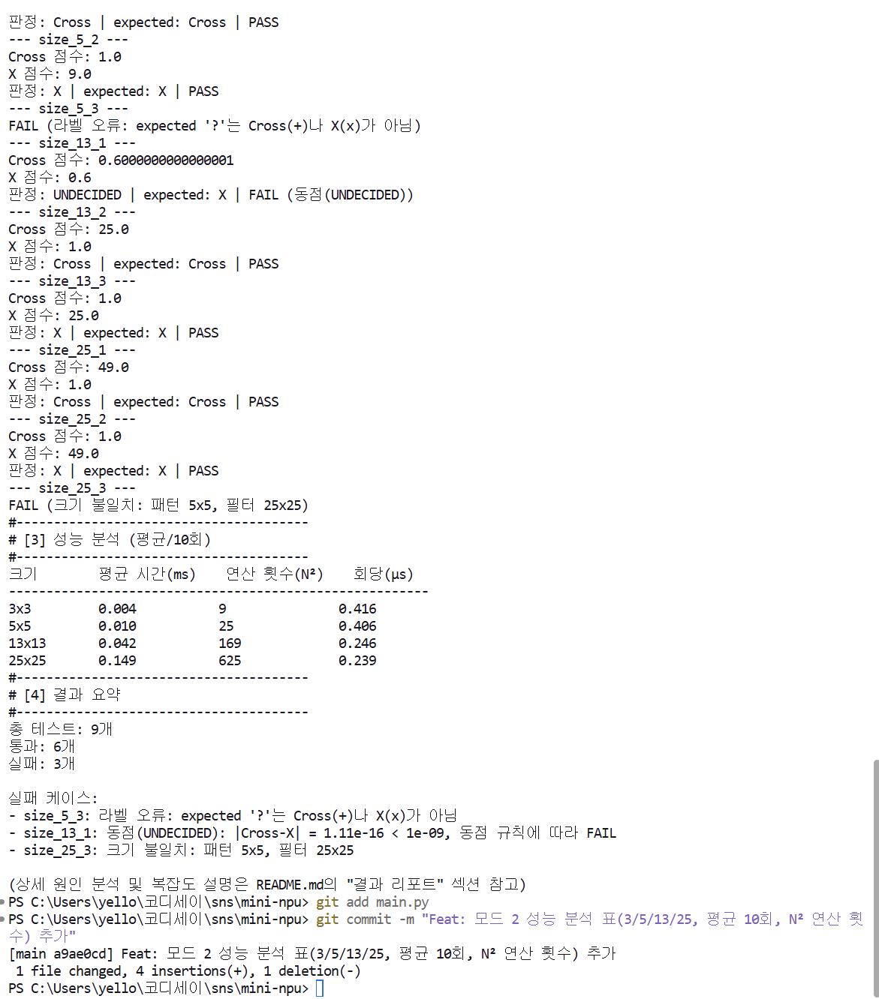

# Mini NPU 시뮬레이터

십자가(Cross)와 X 패턴을 **MAC(곱하고 더하기) 연산 점수**로 판별하는 Python 콘솔 프로그램입니다. NumPy 없이 반복문만 사용했습니다.

> 🆕 **평가 피드백을 반영했습니다.** 바뀐 곳은 🔧(코드) 🧪(테스트) 📝(문서) 📊(측정·증빙) 아이콘으로 표시했고, 전체 목록은 [8장](#8-평가-피드백-반영-보완-내용)에 있습니다.

📝 **점수 읽는 법:** MAC 점수는 *패턴과 필터가 같은 위치에서 함께 1인 칸의 수*입니다. **높은 MAC 점수는 필터와 입력이 더 많이 일치한다(더 닮았다)는 뜻**이고, 두 필터 중 점수가 더 높은 쪽으로 판정합니다. 예: 십자가 패턴은 십자가 필터와 5점, X 필터와 1점이라서 Cross로 판정됩니다.

## 1. 실행 방법

```
python main.py
```

| 선택 | 모드 | 설명 |
|---|---|---|
| 1 | 사용자 입력 (3x3) | 필터 A, 필터 B, 패턴을 한 줄에 3개씩 **공백으로 구분**해 입력 (예: `0 1 0`) |
| 2 | data.json 분석 | 필터 3종(5x5, 13x13, 25x25)과 테스트 케이스 9개를 자동 판정하고 성능 표와 결과 요약 출력 |

| 3 | 보너스 | N(3~25)을 입력하면 N×N 십자가·X 패턴을 자동 생성해 판정하고, 2차원 vs 1차원 배열 MAC 성능을 비교 |

- Python 3.8 이상, 외부 라이브러리 없음
- `data.json`은 `main.py`와 같은 폴더에 있어야 합니다.

### 1-1. 📝 모드 1 입력 예시와 출력 형식
입력은 **공백이든 탭이든 상관없이** 숫자들을 나눠 읽고, 앞뒤 공백과 여러 칸 공백도 무시합니다. (`line.split()` 사용) 🧪 `test_tabs_and_extra_spaces_are_accepted`

| 입력한 줄 | 결과 |
|---|---|
| `0 1 0` | ✅ 정상 |
| `0<탭>1<탭>0`, `  1   1   1  ` | ✅ 정상 (탭, 여러 칸 공백, 앞뒤 공백 허용) |
| `010` (붙여 씀) | ❌ 숫자 하나(10)로 읽혀 열 개수 불일치 → 안내 후 **그 줄만** 재입력 |
| `1 2`, `a b c`, (빈 줄) | ❌ `입력 형식 오류: 각 줄에 3개의 숫자를 공백으로 구분해 입력하세요.` |

출력 형식은 항상 아래와 같습니다. (점수는 **실수 그대로**, 시간은 **밀리초, 소수 셋째 자리**)
```text
A 점수: 1.0
B 점수: 5.0
연산 시간(평균/10회): 0.012 ms
판정: B
```

### 1-2. 📝 data.json 스키마와 예외 처리 정책
| 구분 | 기대 형식 | 규칙 |
|---|---|---|
| `filters` | `size_{N}` 키, 값은 `{"cross": N×N, "x": N×N}` | 키의 N과 실제 필터 크기가 같아야 함. 라벨 키(`cross`, `x`)는 정규화함 |
| `patterns` | `size_{N}_{idx}` 키, 값은 `{"input": N×N, "expected": 라벨}` | **키의 N으로 `size_N` 필터를 고름.** 패턴 크기도 N이어야 함 |

| 잘못된 데이터 | 처리 정책 |
|---|---|
| `filters`에서 `size_숫자` 형식이 아닌 키 | **건너뜀**(무시) |
| 필터의 크기·라벨·모양 오류 | 해당 크기 필터를 `✗ … 로드 실패`로 표시하고, 그 크기 패턴은 모두 FAIL |
| 패턴 키가 `size_{N}_{idx}`가 아님, `input`/`expected` 없음 | 그 케이스만 FAIL (`스키마 오류`) |
| `expected`가 알 수 없는 라벨 | 그 케이스만 FAIL (`라벨 오류`) |
| 패턴과 필터 크기 불일치 | 그 케이스만 FAIL (`크기 불일치`) |
| 파일이 없거나 JSON이 깨짐 | 안내 후 종료 (프로그램은 비정상 종료하지 않음) |

## 2. 구현 요약

- `Grid`: N x N 숫자표 (입력 검증, 값 읽기/쓰기, 출력)
- `mac(pattern, filter)`: 같은 칸끼리 곱해서 모두 더하는 연산 (크기가 다르면 오류)
  - 📝 **반복 순서:** 바깥 반복이 행, 안쪽 반복이 열인 **행 우선(row-major)** 입니다. 파이썬 리스트는 같은 행의 칸이 메모리에서 이웃해 있어 이 순서가 가장 자연스럽고, 순서가 바뀌어도 연산 횟수(N²)는 같습니다. 정밀도는 **더하는 순서에 따라 마지막 자리 오차**가 달라질 수 있어서(예: `0.1+0.2+0.3`) 허용오차 비교를 씁니다. 0과 1만 쓰는 패턴은 합이 정수라 오차가 생기지 않습니다.
- `normalize_label`: `+`, `cross` → `Cross` / `x` → `X` 로 표기를 통일. 🔧 표기 목록은 `LABEL_ALIASES` 딕셔너리 한 곳에 모았습니다.
  - 📝 **함수로 분리한 이유:** ① **중앙집중화** — 필터 키, expected, 출력 비교가 모두 같은 규칙을 쓰므로 표기 규칙이 어긋날 수 없음 ② **재사용성** — 필터 로드와 패턴 분석 두 곳에서 같은 함수를 호출 ③ **테스트 용이성** — 입출력이 단순해 한 줄씩 시험 가능(🧪 `LabelTests`) ④ **확장 용이성** — 새 표기는 `LABEL_ALIASES`에 한 줄만 추가(8-3 체크리스트).
- 판정: 두 점수 차이가 `1e-9` 미만이면 **동점**으로 보고 판정 불가(UNDECIDED)로 처리 (부동소수점 오차 대비)
  - 📊 **EPSILON `1e-9`을 고른 근거(실험):** ① `data.json`의 정상 케이스 점수 차이는 **최소 8**, 부동소수점 동점 케이스(`size_13_1`)는 **`1.11e-16`** 이라 두 집단이 아주 멀리 떨어져 있습니다. ② 소수 0.1 단위 값 625개를 서로 반대 순서로 더하는 실험을 2만 번 했을 때 **순서 때문에 생긴 최대 차이는 `1.14e-12`** 였습니다. ③ 따라서 `1e-9`은 실제 오차(`~1e-12`)보다 약 **1,000배 크고**, 실제 점수 차이(≥1)보다 **10억 배 작아서** 오차만 동점으로 걸러내고 진짜 차이는 놓치지 않습니다.
- 문제가 있는 케이스는 프로그램을 멈추지 않고 그 케이스만 FAIL로 기록하고 다음으로 진행

## 3. 실행 결과 (증빙)

| 화면 | 파일 |
|---|---|
| 모드 1 잘못된 입력 처리 + 커밋 | `docs/screenshots/M7_mode1_error_commit.png` |
| 모드 1 판정 결과 + 3x3 성능 표 | `docs/screenshots/M6_mode1_result.png` |
| 모드 2 분석 커밋 | `docs/screenshots/M8_mode2_commit.png` |
| 모드 2 성능 표 + 결과 요약 | `docs/screenshots/M9_mode2_perf_summary_commit.png` |



## 4. 결과 리포트

### 4-1. 요약

| 항목 | 값 |
|---|---|
| 총 테스트 | 9개 |
| 통과 | 6개 |
| 실패 | 3개 |

**🔧📝 실패 유형별 통계 (콘솔의 `결과 요약`에도 출력됩니다)**

| 실패 유형 | 개수 | 케이스 | 원인 분류 |
|---|---|---|---|
| 동점(UNDECIDED) | 1 | size_13_1 | 수치 비교 |
| 라벨 오류 | 1 | size_5_3 | 데이터·스키마 |
| 크기 불일치 | 1 | size_25_3 | 데이터·스키마 |
| 판정 불일치(로직) | 0 | - | 로직 |
| **합계** | **3** | | |

📊 **기계가 읽기 쉬운 요약 (한 줄 표)**

| total | pass | fail | fail_label | fail_size | fail_tie | fail_schema | fail_logic |
|---|---|---|---|---|---|---|---|
| 9 | 6 | 3 | 1 | 1 | 1 | 0 | 0 |

📝 **동점은 어떻게 집계되나요?** 동점(UNDECIDED)은 정답을 정할 수 없는 상태이므로 expected와 상관없이 **FAIL로 집계**하고, 아래처럼 `동점(UNDECIDED)` 이라는 별도 유형으로 표시합니다. 로그 예시:
```text
--- size_13_1 ---
Cross 점수: 0.6000000000000001
X 점수: 0.6
판정: UNDECIDED | expected: X | FAIL (동점(UNDECIDED))
...
실패 유형별 개수:
- 동점(UNDECIDED): 1건
```

📝 **모드 1과 모드 2의 동점 처리 차이**

| | 모드 1 (사용자 입력) | 모드 2 (data.json) |
|---|---|---|
| 동점일 때 출력 | `판정: 판정 불가 (\|A-B\| < 1e-9)` | `판정: UNDECIDED` |
| expected와 비교 | 없음 (정답이 없음) | 있음 → 동점이면 FAIL로 집계 |
| 이유 | 사용자가 A/B를 직접 비교하는 용도 | 자동 채점이라 PASS/FAIL이 필요 |

### 4-2. 실패 케이스 원인 분석

| 케이스 | 실패 메시지 | 원인 분류 |
|---|---|---|
| size_13_1 | 동점(UNDECIDED), \|Cross-X\| = 1.11e-16 | 수치 비교 문제 |
| size_5_3 | 라벨 오류: expected `?` | 데이터·스키마 문제 |
| size_25_3 | 크기 불일치: 패턴 5x5, 필터 25x25 | 데이터·스키마 문제 |

**수치 비교 문제 (size_13_1)**
1. 이 케이스에서 Cross 점수는 `0.6000000000000001`, X 점수는 `0.6`으로 출력되었습니다.
2. 수학으로는 `0.1 + 0.2 + 0.3`이 둘 다 0.6이어야 하지만, 컴퓨터는 소수를 2진수로 저장해 더하는 순서에 따라 아주 작은 오차가 생깁니다.
3. 차이는 약 `1.11e-16`으로 사람이 보기에는 같은 점수입니다.
4. 그런데 `==`나 `>`로 단순 비교하면 Cross가 아주 조금 커서 Cross로 잘못 판정됩니다. 정답은 X로 되어 있으므로 틀리게 됩니다.
5. 그래서 두 점수 차이가 허용오차 `1e-9`보다 작으면 같은 점수로 보고 UNDECIDED로 처리하는 규칙을 넣었습니다.
6. 이 케이스는 일부러 동점 상황을 만든 데이터이므로, 규칙에 따라 FAIL로 기록되는 것이 올바른 동작입니다. 오차 때문에 엉뚱한 판정이 나오는 것보다 "판정 불가"라고 알려주는 편이 더 정직합니다.

**데이터·스키마 문제 (size_5_3, size_25_3)**
7. size_5_3은 정답(expected) 값이 `?`였습니다. 정답은 Cross(`+`) 또는 X(`x`)만 가능하므로 라벨 표기를 통일하는 단계에서 걸러져 "라벨 오류"로 기록됩니다.
8. size_25_3은 패턴이 5x5인데 필터는 25x25라서 칸이 서로 맞지 않습니다. MAC은 같은 위치끼리 곱하므로 크기가 다르면 계산할 수 없고 "크기 불일치"로 기록됩니다.
9. 두 경우 모두 프로그램 코드의 오류가 아니라 입력 데이터가 잘못된 것입니다. 그래서 프로그램은 멈추지 않고 그 케이스만 FAIL로 표시한 뒤 나머지 케이스를 계속 처리합니다.
10. 만약 이 검사가 없었다면 프로그램이 중간에 오류로 멈춰서 뒤에 있는 정상 케이스 결과까지 볼 수 없었을 것입니다.

**로직 문제는 없었던 이유**
11. 이번 실패 3건은 모두 수치 비교 또는 데이터 문제였고, MAC 계산과 판정 규칙 자체가 틀려서 생긴 실패는 없었습니다. 나머지 6개는 기대한 정답과 일치했고, 잡음이 섞인 X 패턴(size_13_3)도 정상적으로 X로 판정되었습니다.
12. 라벨 표기가 케이스마다 `cross`/`Cross`로 달라도 정규화 덕분에 같은 라벨로 처리되었습니다.

### 4-3. 성능 분석 (직접 측정)

각 크기를 10번 반복해 평균을 냈고, 시간은 `time.perf_counter()`로 쟀습니다.

| 크기 | 평균 시간(ms) | 연산 횟수(N²) | 회당(µs) |
|---|---|---|---|
| 3x3 | 0.004 | 9 | 0.416 |
| 5x5 | 0.010 | 25 | 0.406 |
| 13x13 | 0.042 | 169 | 0.246 |
| 25x25 | 0.149 | 625 | 0.239 |

- 📝 **표 읽는 법:** `평균 시간(ms)` = 10번 잰 시간의 평균(밀리초, 소수 3자리), `연산 횟수(N²)` = N×N, `회당(µs)` = `평균 시간(ms) × 1000 ÷ N²` (곱셈 한 번당 마이크로초).
- 📝 **측정 경계:** `time.perf_counter()`로 **`mac()` 함수 호출 직전과 직후만** 잽니다. 입력 읽기, 파일(`data.json`) 읽기, 화면 출력, 패턴·필터 만들기(`make_cross`)는 측정에서 **제외**합니다.
- **연산 횟수는 N²** 입니다. 크기가 5x5에서 25x25로 5배 커지면 연산 횟수는 25배(25 → 625)가 됩니다.
  - 📝 수식으로: 연산 횟수 = N². N을 k배 하면 (kN)² = **k²·N²** 이므로 연산은 k² 배. 예: N=5 → 25 (25회), N=10 → 100 (4배), N=25 → 625 (25배), N=100 → 10,000 (400배).
- 측정 시간도 같은 방향으로 늘었습니다. 5x5(0.010ms)에서 25x25(0.149ms)로 약 15배입니다.
- 25배가 아니라 약 15배인 이유는 **작은 크기에서는 함수 호출 같은 고정 비용이 시간의 큰 부분**을 차지하기 때문입니다. 그래서 칸 하나당 시간(µs)은 큰 크기일수록 약간 줄어들어 0.24µs 안팎으로 안정됩니다.
- 결론: MAC 연산은 시간 복잡도 **O(N²)** 입니다. 크기가 커질수록 계산량이 제곱으로 늘어나므로, 실제 NPU는 이 곱셈·덧셈을 한꺼번에 처리하는 전용 하드웨어를 씁니다.
- 시간 값은 컴퓨터와 실행 시점에 따라 조금씩 달라질 수 있습니다. 연산 횟수는 항상 같습니다.

📝 **CPU와 NPU의 병목 비교**

| | CPU | NPU |
|---|---|---|
| 처리 방식 | 소수의 강력한 코어가 명령을 **직렬**(순서대로)로 처리 | 수천 개의 단순한 **MAC 유닛**이 곱셈·덧셈을 **동시에(병렬)** 처리 |
| 대표 병목 | **연산 병렬성 부족**: 곱셈을 한 번에 몇 개밖에 못 함. 이 프로그램의 이중 반복문이 그 예 | **메모리 대역폭**: 연산 유닛은 빠른데 필터·입력 값을 메모리에서 가져오는 속도가 모자라 놀게 됨 |
| 해결 방향 | 벡터·SIMD, 멀티코어 | 값을 칩 안 버퍼에 재사용(데이터 이동 줄이기), 낮은 정밀도(int8) 사용 |

즉 **CPU는 계산할 수 있는 개수가 병목이고, NPU는 데이터를 가져오는 속도가 병목**입니다.

## 5. 보너스 과제 결과 (모드 3)

### 5-1. 패턴 생성기
- `make_cross(n)`, `make_x(n)`가 N×N 십자가(가운데 행·열)와 X(두 대각선)를 자동으로 만듭니다.
- 생성한 패턴은 모드 3의 판정(7x7 입력 시 Cross 패턴 → Cross 13.0 vs X 1.0, X 패턴 → Cross 1.0 vs X 13.0)과 성능 분석에 그대로 재사용합니다.

### 5-2. 1차원 배열 최적화 (2차원 vs 1차원)
2차원 배열을 길이 N²의 1차원 리스트로 편 뒤(`flatten`), `get(i, j)` 호출 없이 인덱스 하나로 접근하는 `mac_flat()`으로 계산했습니다. 같은 입력, 같은 10회 반복으로 비교했고, 배열을 펴는 시간은 제외했습니다.

| 크기 | 2D 평균(ms) | 1D 평균(ms) | 속도 향상 | 점수 |
|---|---|---|---|---|
| 3x3 | 0.002 | 0.001 | 1.77배 | 일치 |
| 5x5 | 0.011 | 0.005 | 2.23배 | 일치 |
| 13x13 | 0.051 | 0.011 | 4.71배 | 일치 |
| 25x25 | 0.196 | 0.081 | 2.41배 | 일치 |
| 7x7 | 0.012 | 0.004 | 3.35배 | 일치 |


- 모든 크기에서 1차원 방식이 약 2~5배 빨랐고 점수는 동일했습니다.
- 빨라진 주된 이유는 칸마다 `get()` 메서드를 부르는 비용과 이중 반복문의 오버헤드가 사라졌기 때문입니다.
- 연산 횟수는 여전히 N²이므로 **시간 복잡도는 O(N²) 그대로**이고, 줄어든 것은 한 칸당 걸리는 상수 시간입니다.
- 10회 평균이라 측정마다 배율이 조금씩 흔들립니다. 같은 컴퓨터에서도 2~10배 사이로 달라지는 것을 관찰했습니다.

### 5-3. 📊 큰 N에서의 메모리와 우선순위 최적화
`tracemalloc`과 `time.perf_counter()`로 큰 N을 직접 측정했습니다. (N×N 격자 하나, 한 번 측정한 참고값)

| N | 칸 수 (N²) | 2차원 `Grid` 메모리 | `mac` 2D | `mac_flat` 1D |
|---|---|---|---|---|
| 25 | 625 | 0.01 MB | 0.1 ms | 0.1 ms |
| 100 | 10,000 | 0.09 MB | 1.5 ms | 0.6 ms |
| 500 | 250,000 | 1.96 MB | 43.4 ms | 18.5 ms |
| 1000 | 1,000,000 | 7.73 MB | 172.1 ms | 59.2 ms |

- **메모리 ≈ 칸당 약 8바이트 × N²** 입니다. 패턴과 필터가 각각 있어야 하므로 N=1000이면 격자 두 개로 **약 16 MB**, N=10,000이면 약 **1.6 GB**로 커져서 일반 PC의 메모리 한계에 다가갑니다.
- **우선순위 최적화 항목:** ① 1차원 배열(구현함, 약 2~3배 빠름) → ② 값이 0/1뿐이면 `bytearray`나 정수 리스트로 칸당 메모리 줄이기 → ③ 필터가 1인 칸의 위치만 모아 그 칸만 더하기(희소 계산) → ④ `multiprocessing`으로 행을 나눠 병렬 처리(이 과제는 표준 라이브러리만 허용해 구현하지 않음).

## 6. 재현성

- 같은 `data.json`으로 실행하면 판정 결과(통과 6, 실패 3)와 실패 사유는 항상 같습니다.
- 성능 표의 시간만 실행 환경에 따라 달라집니다.
- `python main.py` → `2`를 선택하면 위 결과를 그대로 다시 볼 수 있습니다.

## 7. 파일 구성

```
mini-npu/
├── main.py        # 프로그램 전체
├── test_mini_npu.py   # 🧪 자동 테스트 16개 (unittest)
├── data.json      # 필터 3종 + 테스트 케이스 9개
├── README.md      # 이 문서
├── .gitignore
└── docs/screenshots/   # 실행·커밋 증빙
```

## 8. 평가 피드백 반영 (보완 내용)
평가에서 **20개 항목 중 PASS 16개, FAIL 4개(#12, #14, #18, #20)** 를 받았고, 보완 의견을 모두 반영했습니다. 아이콘 의미는 다음과 같습니다.

| 아이콘 | 뜻 |
|---|---|
| 🔧 | 코드를 고침 (`main.py`) |
| 🧪 | 자동 테스트를 추가함 (`test_mini_npu.py`) |
| 📝 | 문서(README)를 보강함 |
| 📊 | 측정·실험·증빙을 보강함 |

### 8-1. 보완 내역 한눈에 보기
| 평가 | 지적 | 보완 | 위치 | 표시 |
|---|---|---|---|---|
| #1 | 모드 1 출력 형식 명시 | 출력 예시와 단위 | 1-1 | 📝 |
| #2 | EPSILON 근거 | 실험(차이 최소 8, 오차 최대 1.14e-12) | 2장 | 📊 📝 |
| #3 | 탭·다중 공백 사례 | 입력 예시 표, 테스트 | 1-1 | 📝 🧪 |
| #4 | 스키마·예외 정책 | 스키마와 정책 표 | 1-2 | 📝 |
| #5 | 지원 라벨 목록 | `LABEL_ALIASES`와 지원 목록 | 2장, 8-3 | 🔧 📝 |
| #6 | 동점 로그 예시 | 동점 집계 설명과 로그 | 4-1 | 📝 |
| #7 | 성능표 단위·계산식 | 표 읽는 법 | 4-3 | 📝 |
| #8 | 실패 유형별 통계 | **콘솔 요약에 유형별 개수 출력** | 4-1, 콘솔 | 🔧 🧪 |
| #9 | 기계가 읽기 쉬운 요약 | 한 줄 요약 표 | 4-1 | 📝 |
| #10 | MAC 반복 순서 영향 | 행 우선과 정밀도 설명 | 2장 | 📝 |
| #11 | size_N 대응 규칙 | 스키마 표 | 1-2 | 📝 |
| **#12** | **normalize_label 분리 이유** | 중앙집중·재사용·테스트·확장 설명 | 2장 | 📝 🔧 |
| #13 | 측정 경계 | 측정 시점과 제외 항목 | 4-3 | 📝 |
| **#14** | **점수 해석 문장** | "높은 MAC 점수 = 더 많이 일치" | 맨 위 | 📝 |
| #15 | 복잡도 수식 예시 | k² 배 수식과 예 | 4-3 | 📝 |
| #16 | EPSILON 실험적 근거 | #2와 같은 실험 | 2장 | 📊 |
| #17 | 모드별 동점 처리 차이 | 비교 표 | 4-1 | 📝 |
| **#18** | **새 라벨 추가 절차** | 체크리스트와 테스트 | 8-3 | 📝 🧪 |
| #19 | 큰 N 메모리·최적화 우선순위 | 실측 표와 우선순위 | 5-3 | 📊 📝 |
| **#20** | **CPU vs NPU 병목** | 비교 표 | 4-3 | 📝 |

### 8-2. 테스트 구성 🧪
| 테스트 클래스 | 검증 내용 | 개수 |
|---|---|---|
| `LabelTests` | 라벨 정규화, 모르는 라벨, 새 표기 추가 | 3 |
| `MacTests` | 문서 예시(5, 1), 크기 불일치, 1D와 2D 일치, 생성 패턴 판정 | 4 |
| `TieTests` | 부동소수점 동점, 모드별 문구, 명확한 차이 | 3 |
| `InputTests` | 탭·다중 공백, 잘못된 줄 재입력, 중단 | 3 |
| `Mode2Tests` | 총 9·통과 6·실패 3, 실패 유형별 개수, 연산 횟수 N² | 3 |

실행: `python test_mini_npu.py` → `Ran 16 tests ... OK`

📊 실행 화면 (16개 모두 `ok`, 마지막에 `Ran 16 tests` / `OK`):


### 8-3. 새 라벨을 추가하는 절차 (체크리스트) 📝 🧪
지원하는 표기는 현재 `+`, `cross`, `Cross`(대소문자 무시)가 **Cross**, `x`, `X`가 **X**입니다. `PLUS`, `✚` 같은 변형은 **지원하지 않으며**, 필요하면 아래 순서로 추가합니다.

1. 🔧 `main.py`의 `LABEL_ALIASES`에 한 줄 추가 (소문자 기준, 예: `"plus": "Cross"`)
2. 📝 `data.json`의 `filters` 키와 `patterns`의 `expected`에 새 표기를 써도 되는지 확인 (표준 라벨 `Cross`, `X`는 바꾸지 않음)
3. 🧪 `test_mini_npu.py`의 `LabelTests`에 새 표기 시험 추가 (`test_new_alias_needs_only_one_line` 참고)
4. 📊 `python test_mini_npu.py`와 `python main.py` → `2`를 실행해 총 9·통과 6·실패 3이 **그대로인지** 확인 (기존 결과가 바뀌면 안 됨)
5. 📝 README의 지원 목록(이 절)을 갱신
