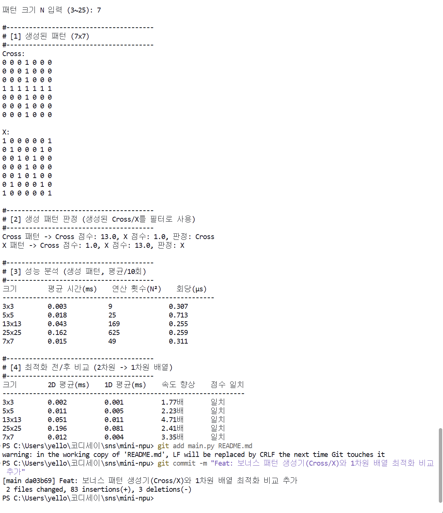

# Mini NPU 시뮬레이터

십자가(Cross)와 X 패턴을 **MAC(곱하고 더하기) 연산 점수**로 판별하는 Python 콘솔 프로그램입니다. NumPy 없이 반복문만 사용했습니다.

## 1. 실행 방법

```
python main.py
```

| 선택 | 모드 | 설명 |
|---|---|---|
| 1 | 사용자 입력 (3x3) | 필터 A, 필터 B, 패턴을 한 줄에 3개씩 **공백으로 구분**해 입력 (예: `0 1 0`) |
| 2 | data.json 분석 | 필터 3종(5x5, 13x13, 25x25)과 테스트 케이스 9개를 자동 판정하고 성능 표와 결과 요약 출력 |

| 3 | 보너스 | N(3~25)을 입력하면 N×N 십자가·X 패턴을 자동 생성해 판정하고, 2차원 vs 1차원 배열 MAC 성능을 비교 |

- Python 3.8 이상, 외부 라이브러리 없음
- `data.json`은 `main.py`와 같은 폴더에 있어야 합니다.

## 2. 구현 요약

- `Grid`: N x N 숫자표 (입력 검증, 값 읽기/쓰기, 출력)
- `mac(pattern, filter)`: 같은 칸끼리 곱해서 모두 더하는 연산 (크기가 다르면 오류)
- `normalize_label`: `+`, `cross` → `Cross` / `x` → `X` 로 표기를 통일
- 판정: 두 점수 차이가 `1e-9` 미만이면 **동점**으로 보고 판정 불가(UNDECIDED)로 처리 (부동소수점 오차 대비)
- 문제가 있는 케이스는 프로그램을 멈추지 않고 그 케이스만 FAIL로 기록하고 다음으로 진행

## 3. 실행 결과 (증빙)

| 화면 | 파일 |
|---|---|
| 모드 1 잘못된 입력 처리 + 커밋 | `docs/screenshots/M7_mode1_error_commit.png` |
| 모드 1 판정 결과 + 3x3 성능 표 | `docs/screenshots/M6_mode1_result.png` |
| 모드 2 분석 커밋 | `docs/screenshots/M8_mode2_commit.png` |
| 모드 2 성능 표 + 결과 요약 | `docs/screenshots/M9_mode2_perf_summary_commit.png` |


## 4. 결과 리포트

### 4-1. 요약

| 항목 | 값 |
|---|---|
| 총 테스트 | 9개 |
| 통과 | 6개 |
| 실패 | 3개 |

### 4-2. 실패 케이스 원인 분석

| 케이스 | 실패 메시지 | 원인 분류 |
|---|---|---|
| size_13_1 | 동점(UNDECIDED), \|Cross-X\| = 1.11e-16 | 수치 비교 문제 |
| size_5_3 | 라벨 오류: expected `?` | 데이터·스키마 문제 |
| size_25_3 | 크기 불일치: 패턴 5x5, 필터 25x25 | 데이터·스키마 문제 |

**수치 비교 문제 (size_13_1)**
1. 이 케이스에서 Cross 점수는 `0.6000000000000001`, X 점수는 `0.6`으로 출력되었습니다.
2. 수학으로는 `0.1 + 0.2 + 0.3`이 둘 다 0.6이어야 하지만, 컴퓨터는 소수를 2진수로 저장해 더하는 순서에 따라 아주 작은 오차가 생깁니다.
3. 차이는 약 `1.11e-16`으로 사람이 보기에는 같은 점수입니다.
4. 그런데 `==`나 `>`로 단순 비교하면 Cross가 아주 조금 커서 Cross로 잘못 판정됩니다. 정답은 X로 되어 있으므로 틀리게 됩니다.
5. 그래서 두 점수 차이가 허용오차 `1e-9`보다 작으면 같은 점수로 보고 UNDECIDED로 처리하는 규칙을 넣었습니다.
6. 이 케이스는 일부러 동점 상황을 만든 데이터이므로, 규칙에 따라 FAIL로 기록되는 것이 올바른 동작입니다. 오차 때문에 엉뚱한 판정이 나오는 것보다 "판정 불가"라고 알려주는 편이 더 정직합니다.

**데이터·스키마 문제 (size_5_3, size_25_3)**
7. size_5_3은 정답(expected) 값이 `?`였습니다. 정답은 Cross(`+`) 또는 X(`x`)만 가능하므로 라벨 표기를 통일하는 단계에서 걸러져 "라벨 오류"로 기록됩니다.
8. size_25_3은 패턴이 5x5인데 필터는 25x25라서 칸이 서로 맞지 않습니다. MAC은 같은 위치끼리 곱하므로 크기가 다르면 계산할 수 없고 "크기 불일치"로 기록됩니다.
9. 두 경우 모두 프로그램 코드의 오류가 아니라 입력 데이터가 잘못된 것입니다. 그래서 프로그램은 멈추지 않고 그 케이스만 FAIL로 표시한 뒤 나머지 케이스를 계속 처리합니다.
10. 만약 이 검사가 없었다면 프로그램이 중간에 오류로 멈춰서 뒤에 있는 정상 케이스 결과까지 볼 수 없었을 것입니다.

**로직 문제는 없었던 이유**
11. 이번 실패 3건은 모두 수치 비교 또는 데이터 문제였고, MAC 계산과 판정 규칙 자체가 틀려서 생긴 실패는 없었습니다. 나머지 6개는 기대한 정답과 일치했고, 잡음이 섞인 X 패턴(size_13_3)도 정상적으로 X로 판정되었습니다.
12. 라벨 표기가 케이스마다 `cross`/`Cross`로 달라도 정규화 덕분에 같은 라벨로 처리되었습니다.

### 4-3. 성능 분석 (직접 측정)

각 크기를 10번 반복해 평균을 냈고, 시간은 `time.perf_counter()`로 쟀습니다.

| 크기 | 평균 시간(ms) | 연산 횟수(N²) | 회당(µs) |
|---|---|---|---|
| 3x3 | 0.004 | 9 | 0.416 |
| 5x5 | 0.010 | 25 | 0.406 |
| 13x13 | 0.042 | 169 | 0.246 |
| 25x25 | 0.149 | 625 | 0.239 |

- **연산 횟수는 N²** 입니다. 크기가 5x5에서 25x25로 5배 커지면 연산 횟수는 25배(25 → 625)가 됩니다.
- 측정 시간도 같은 방향으로 늘었습니다. 5x5(0.010ms)에서 25x25(0.149ms)로 약 15배입니다.
- 25배가 아니라 약 15배인 이유는 **작은 크기에서는 함수 호출 같은 고정 비용이 시간의 큰 부분**을 차지하기 때문입니다. 그래서 칸 하나당 시간(µs)은 큰 크기일수록 약간 줄어들어 0.24µs 안팎으로 안정됩니다.
- 결론: MAC 연산은 시간 복잡도 **O(N²)** 입니다. 크기가 커질수록 계산량이 제곱으로 늘어나므로, 실제 NPU는 이 곱셈·덧셈을 한꺼번에 처리하는 전용 하드웨어를 씁니다.
- 시간 값은 컴퓨터와 실행 시점에 따라 조금씩 달라질 수 있습니다. 연산 횟수는 항상 같습니다.

## 5. 보너스 과제 결과 (모드 3)

### 5-1. 패턴 생성기
- `make_cross(n)`, `make_x(n)`가 N×N 십자가(가운데 행·열)와 X(두 대각선)를 자동으로 만듭니다.
- 생성한 패턴은 모드 3의 판정(7x7 입력 시 Cross 패턴 → Cross 13.0 vs X 1.0, X 패턴 → Cross 1.0 vs X 13.0)과 성능 분석에 그대로 재사용합니다.

### 5-2. 1차원 배열 최적화 (2차원 vs 1차원)
2차원 배열을 길이 N²의 1차원 리스트로 편 뒤(`flatten`), `get(i, j)` 호출 없이 인덱스 하나로 접근하는 `mac_flat()`으로 계산했습니다. 같은 입력, 같은 10회 반복으로 비교했고, 배열을 펴는 시간은 제외했습니다.

| 크기 | 2D 평균(ms) | 1D 평균(ms) | 속도 향상 | 점수 |
|---|---|---|---|---|
| 3x3 | 0.002 | 0.001 | 1.77배 | 일치 |
| 5x5 | 0.011 | 0.005 | 2.23배 | 일치 |
| 13x13 | 0.051 | 0.011 | 4.71배 | 일치 |
| 25x25 | 0.196 | 0.081 | 2.41배 | 일치 |
| 7x7 | 0.012 | 0.004 | 3.35배 | 일치 |



- 모든 크기에서 1차원 방식이 약 2~5배 빨랐고 점수는 동일했습니다.
- 빨라진 주된 이유는 칸마다 `get()` 메서드를 부르는 비용과 이중 반복문의 오버헤드가 사라졌기 때문입니다.
- 연산 횟수는 여전히 N²이므로 **시간 복잡도는 O(N²) 그대로**이고, 줄어든 것은 한 칸당 걸리는 상수 시간입니다.
- 10회 평균이라 측정마다 배율이 조금씩 흔들립니다. 같은 컴퓨터에서도 2~10배 사이로 달라지는 것을 관찰했습니다.

## 6. 재현성

- 같은 `data.json`으로 실행하면 판정 결과(통과 6, 실패 3)와 실패 사유는 항상 같습니다.
- 성능 표의 시간만 실행 환경에 따라 달라집니다.
- `python main.py` → `2`를 선택하면 위 결과를 그대로 다시 볼 수 있습니다.

## 7. 파일 구성

```
mini-npu/
├── main.py        # 프로그램 전체
├── data.json      # 필터 3종 + 테스트 케이스 9개
├── README.md      # 이 문서
├── .gitignore
└── docs/screenshots/   # 실행·커밋 증빙
```
